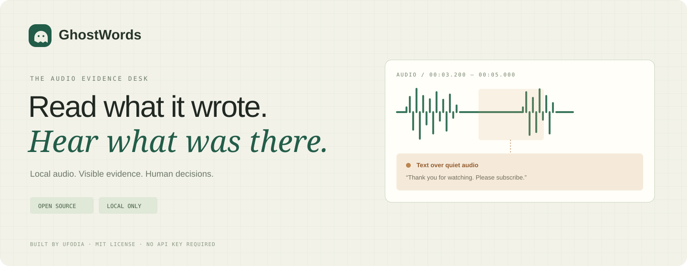
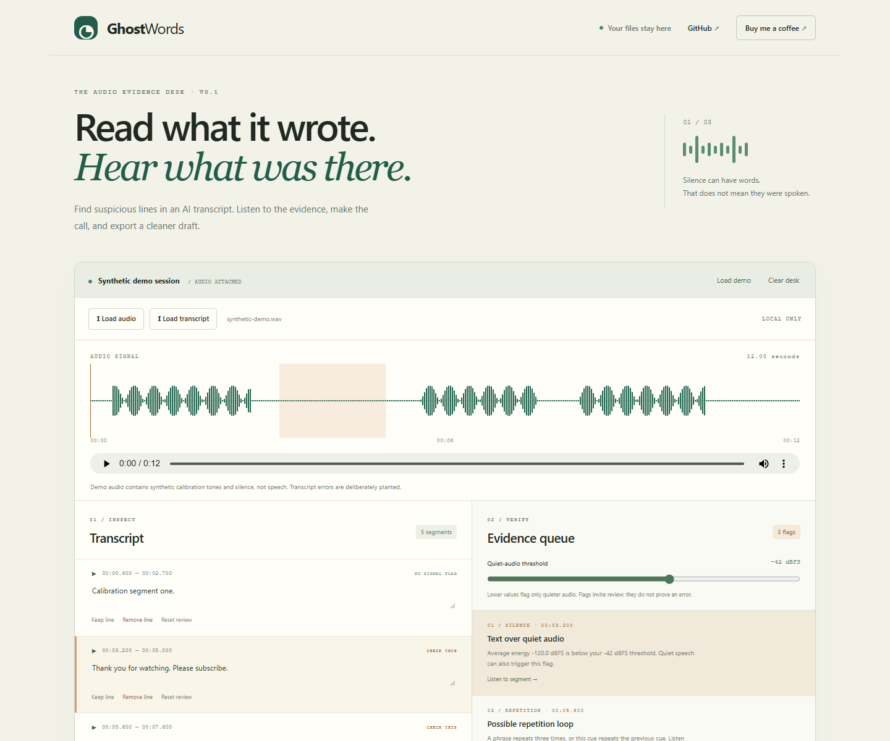

<p align="center"></p>

<p align="center"><a href="#quick-start">Quick start</a> · <a href="docs/user-guide.md">Field guide</a> · <a href="docs/formats.md">File formats</a> · <a href="docs/architecture.md">Architecture</a> · <a href="https://buymeacoffee.com/ufodia">Support Ufodia</a></p>

<p align="center"></p>

**GhostWords is a local audio evidence desk for reviewing suspicious AI transcripts.** Pair an existing transcript with its recording, inspect quiet-audio and repetition flags, listen to the exact segment, and decide what stays.

It does not transcribe audio or certify that a sentence was spoken. It gives you a focused review queue with inspectable evidence.




**[Open the live app ↗](https://ghost-words.vercel.app/)** · [Deployment guide](docs/DEPLOYMENT.md)

## Why it exists

A fluent transcript can include a sentence over silence, a repetition loop, or timestamps from a different recording. Those mistakes are easy to miss when you only read the text. GhostWords brings the audio back into the decision.

### The useful part

| You bring | GhostWords shows | You decide |
| --- | --- | --- |
| A recording and SRT, VTT, or JSON transcript | Low-energy spans, repeated text, overlaps, and cues outside the recording | Listen, edit, keep, or remove each line |

## Quick start

Use **Node.js 24 LTS** and npm. No account, API key, model download, or backend is required.

```sh
git clone https://github.com/ufodia/ghost-words.git
cd ghost-words
npm ci
npm run dev
```

Open the local URL printed by Vite. The desk starts with a **12-second synthetic calibration recording** and five deliberately planted transcript cues. The demo contains tones and silence, not real speech.

1. Select **Text over quiet audio** in the evidence queue.
2. Listen to the marked interval. Notice the lack of audio energy.
3. Choose **Remove line** or **Keep line** after your review.
4. Export the reviewed SRT and evidence JSON.

For your own recording, load its audio file and matching transcript. MP3, WAV, and other formats depend on your browser's decoder support.

## What ships

- **Real local audio:** browser decoding, waveform, recording controls, and segment playback.
- **Three input formats:** SRT, WebVTT, and documented JSON, including multiline cues.
- **Visible evidence:** RMS energy in dBFS, configurable quiet threshold, repetition heuristics, overlap and duration checks.
- **Human review:** editable text and independent keep/remove/reset decisions.
- **Useful exports:** renumbered SRT plus a structured report containing methods, flags, timings, and decisions.
- **No automatic deletion:** pending cues remain in the SRT. Only explicitly removed cues are excluded.

## Data and privacy

Files are processed in the current browser tab. The application makes no upload, inference, analytics, or tracking requests. Data stays in memory and clears when the tab closes or you select **Clear desk**. There is no automatic persistence, so export before closing.

Audio uses a temporary browser object URL, which is revoked when replaced or cleared. Exports contain transcript content; treat them like the source recording. The GitHub and support links open external services only when you follow them. README badges are external images displayed by GitHub, not part of the application.

## Honest boundaries

- Quiet speech, music, legitimate repetition, and multiple speakers can trigger review flags.
- A low RMS value is a signal measurement, not proof of fabricated words.
- Normal-energy audio can still be transcribed incorrectly. No flag does not mean a correct transcript.
- The browser accepts files up to 100 MB and decoded excerpts up to 30 minutes. Transcript text is limited to 2 MB and 10,000 cues.
- Review decisions reset when you load another recording, import a transcript, or edit a cue.

See [limitations and interpretation](docs/limitations.md) before using the output in a publishing workflow.

## Develop and verify

```sh
npm run typecheck
npm test
npm run build
npm run preview
```

The tests cover transcript parsing and rejection, millisecond round trips, planted signal flags, threshold boundaries, overlaps, repetition, review export behavior, and WAV encoding. CI runs type checking, tests, and a production build. It does not deploy or upload anything.

| File | Responsibility |
| --- | --- |
| `src/core.ts` | Transcript contracts, parsing, signal metrics, findings, export, synthetic demo |
| `src/main.ts` | Local file handling, playback, review state, safe DOM rendering |
| `src/style.css` | Responsive editorial workspace |
| `examples/` | Small, non-sensitive transcript inputs |

## Contribute

Reproduce a parsing edge case, improve a false-positive explanation, add a browser compatibility note, or submit a small code change. Start with [CONTRIBUTING.md](CONTRIBUTING.md). Use synthetic or properly anonymized recordings when sharing a problem.

## Support independent tools

If GhostWords saves you a re-listen, you can help Ufodia maintain file compatibility, expand the test corpus, and improve the review experience. Core functionality stays available under the MIT license.

<a href="https://buymeacoffee.com/ufodia"></a>

## License

[MIT](LICENSE) © 2026 **Ufodia**. The source, original artwork, synthetic demo, and supplied examples are covered by this repository's license. Dependency licenses remain with their respective authors.

## Browser checks

The real workbench flow is covered by [Playwright browser tests](docs/BROWSER_TESTS.md), including local exports and mobile layout. Run `npm run test:browser` after installing Chromium.
