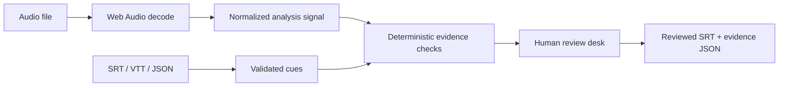

# Architecture

GhostWords is a static TypeScript application built with Vite. There is no application server or model provider. Installation downloads development dependencies; the running application uses browser APIs and local files.

## Core and presentation

`src/core.ts` owns parsing, validation, RMS measurement, repetition matching, timestamp formatting, SRT export, and synthetic fixtures. It has no DOM dependency. `src/main.ts` owns file selection, browser decoding, object URLs, audio controls, canvas drawing, and review state. Imported strings are assigned through DOM `textContent` or textarea values rather than rendered as HTML.

For multichannel audio, the analysis signal keeps the sample with greatest absolute amplitude at each position. This avoids treating opposite-phase stereo channels as silence through cancellation. Playback still uses the original recording. The display waveform is a peak envelope; the quiet-audio check uses interval RMS, so they measure different things.

Energy measurements reuse a WeakMap-cached cumulative index of 1,024-sample block sums. A cue query subtracts full-block totals and scans only the two partial edges (fewer than 2,048 samples). The audio is indexed once, so thousands of overlapping cues and repeated threshold adjustments do not rescan the whole recording per cue. The index uses roughly 8 bytes per 1,024 samples, about 0.7 MB for 30 minutes at 48 kHz. Treat an indexed sample array as immutable; create a new array after modifying audio.

## State lifecycle

The desk keeps cues, findings, decisions, decoded audio, selected cue, and threshold in memory. The current audio object URL is revoked when replaced, cleared, or the page unloads. A generation counter prevents an old asynchronous decode from replacing a newer demo or cleared desk. Only one audio decode runs at a time.

No localStorage, IndexedDB, cookies, telemetry, or service worker is used. Exports happen only through explicit download buttons. Browser memory and developer tooling are outside the application's data lifecycle guarantees.

## Verification

Vitest exercises core behavior with deterministic synthetic signals. TypeScript checks UI/core contracts. The production build validates bundling. Browser review should additionally cover upload, decoding, playback, downloading, keyboard focus, narrow layouts, and codec support. CI has no deployment step.
